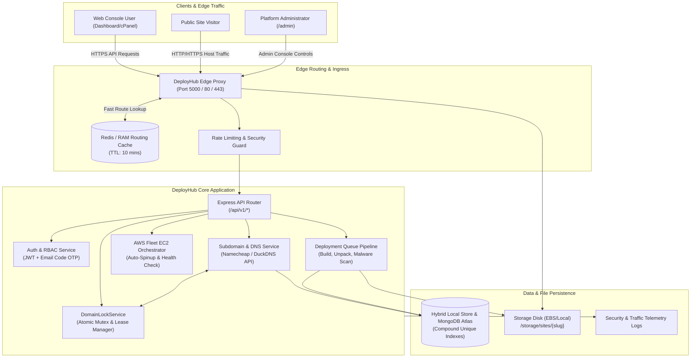
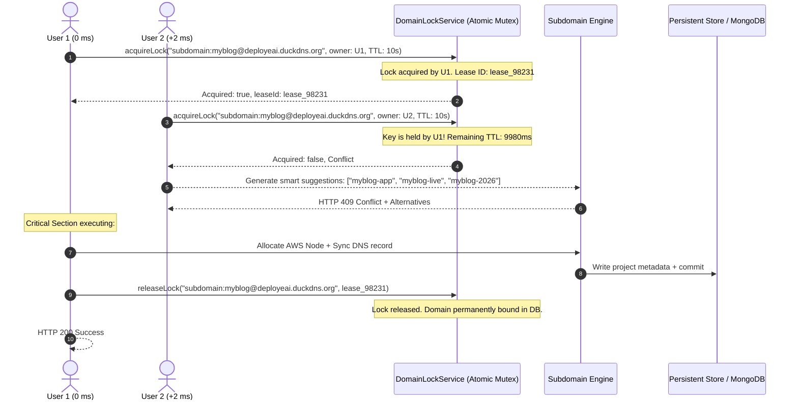
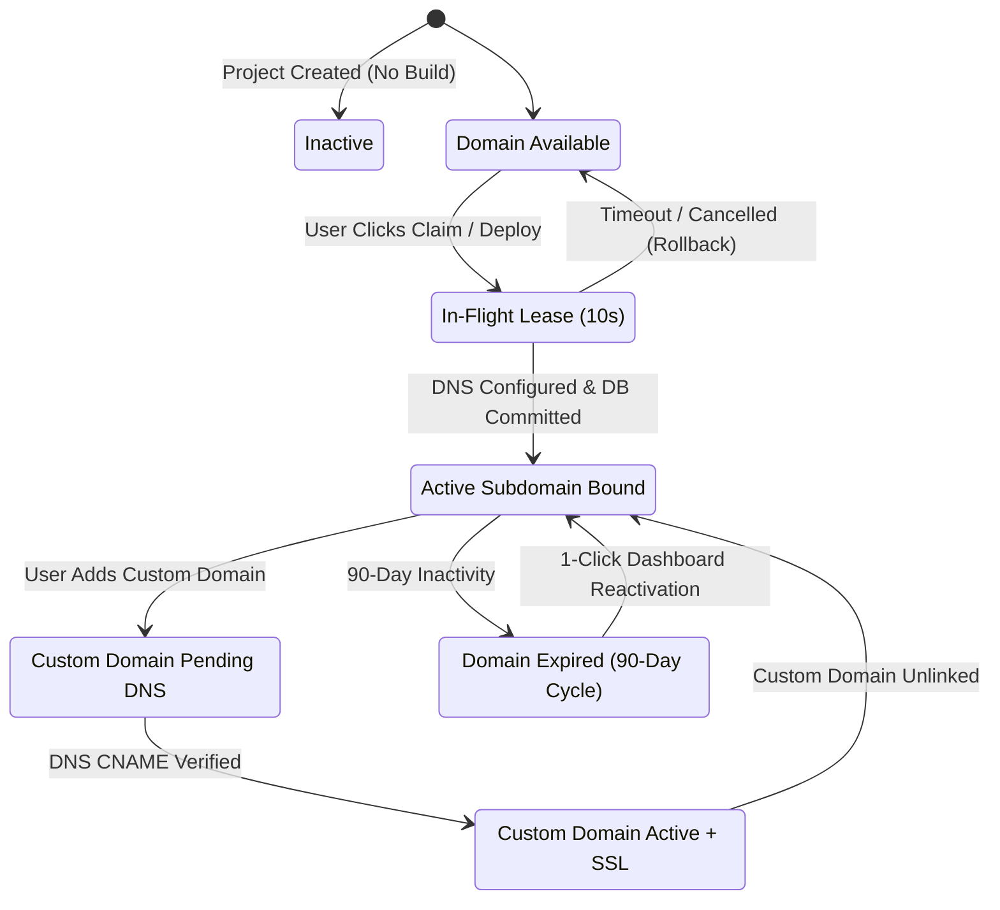

# DeployHub Cloud Platform: High-Level Design (HLD) & System Architecture

## 1. Executive Summary

DeployHub is a distributed cloud hosting platform engineered to provide zero-cost static and PHP web application deployments, automated dynamic DNS management, custom domain mapping, multi-server load routing across AWS EC2 instances, and an integrated web-based cPanel and code editor.

This document outlines the **High-Level Design (HLD)** of the DeployHub architecture, with a particular focus on:
1. **Concurrency Control**: Mathematical calculation and mitigation of simultaneous domain claim collisions (two users claiming the same domain at the exact same millisecond).
2. **Security Architecture**: Multi-level defense covering path traversal, Zip Slip attacks, tenant isolation, host spoofing, and edge proxy request validation.
3. **Domain Management Lifecycle**: Administrative platform domain delegation, dynamic project routing, custom domain CNAME verification, and automated TLS/SSL.

---

## 2. High-Level Architecture Diagram



---

## 3. Simultaneous Domain Claim Concurrency: Problem & Solution

### 3.1 The Concurrency Problem ($T_0$ Millisecond Collision)
When two users ($U_1$ and $U_2$) attempt to register or claim the same subdomain (e.g., `myblog.deployeai.duckdns.org`) or custom domain (e.g., `mybrand.com`) at the exact same time ($T_0$):

```
Time (ms)    User 1 (Thread A)                         User 2 (Thread B)
────────────────────────────────────────────────────────────────────────────────
0 ms         POST /api/v1/subdomains/assign            POST /api/v1/subdomains/assign
             (subdomain: "myblog")                     (subdomain: "myblog")
             │                                         │
2 ms         Step 1: Check DB if "myblog" is taken     │
             Result: Available (false)                 │
             │                                         Step 1: Check DB if "myblog" is taken
10 ms        Step 2: await AWS fleet node query        Result: Available (false) [RACE CONDITION!]
             │                                         │
80 ms        Step 3: await Namecheap DNS API request   Step 2: await AWS fleet node query
             │                                         │
250 ms       Step 4: Write to DB Store                 Step 3: await Namecheap DNS API request
             (myblog -> U1 project)                    │
             │                                         │
310 ms       U1 gets 200 OK                            Step 4: Overwrites DB Store!
                                                       (myblog -> U2 project)
                                                       U2 gets 200 OK [SPLIT-BRAIN FAILURE!]
```

Without concurrency protection, both users receive a `200 OK` success message, but one user silently hijacks or overwrites the other user's edge routing and DNS mapping, creating a catastrophic tenant isolation failure and potential data interception.

---

### 3.2 The 4-Tier Concurrency Architecture

To guarantee zero race conditions, DeployHub employs a 4-tier concurrency defense:



#### Tier 1: Application-Layer Distributed Lock Lease (`DomainLockService`)
- Every domain request forms a canonical lock key:
  - Subdomains: `subdomain:<subdomain>@<platformDomain>`
  - Custom Domains: `custom:<normalizedDomain>`
- Atomic Test-and-Set: When $U_1$ acquires the key, an in-memory lease is issued with a strict 10-second Time-To-Live (TTL).
- Automatic Expiry: If the Node process encounters an uncaught network timeout or crash during DNS provisioning, the lock automatically purges after 10 seconds, preventing deadlocks.

#### Tier 2: Real-time In-Flight Availability Probing
- When $U_2$ queries `/subdomains/check` or submits a claim, the system checks both the persistent database **and** active lock leases in `DomainLockService`.
- If an in-flight lease exists, the system immediately returns `isAvailable: false`, HTTP 409 Conflict, and automatically generates 5 intelligent available permutations (`myblog-app`, `myblog-live`, `myblog-web`, etc.).

#### Tier 3: 2-Phase Domain Commit Protocol
- **Phase 1 (Reserve)**: Acquire lease and claim domain.
- **Phase 2 (Provision & Commit)**: Provision DNS host record, assign AWS EC2 IP, commit to database.
- **Rollback Guarantee**: If any step in Phase 2 fails, the `try...finally` block immediately invokes `domainLockService.releaseLock(key, leaseId)`, freeing the domain for subsequent retry without orphaned state.

#### Tier 4: Database-Level Compound Unique Indexes (Zero-Trust Backstop)
- In MongoDB Atlas, two compound unique indexes are enforced:
  ```javascript
  db.collection('projects').createIndex(
    { assignedSubdomain: 1, platformDomain: 1 },
    { unique: true, sparse: true, name: 'uniq_subdomain_platform' }
  );
  db.collection('projects').createIndex(
    { customDomain: 1 },
    { unique: true, sparse: true, name: 'uniq_custom_domain' }
  );
  ```
- Even in a multi-instance, clustered container deployment behind a load balancer, if two requests bypass Node process memory, the database driver rejects the second write with an `E11000 Duplicate Key Error`.

---

## 4. Security Levels & Vulnerability Mitigations

| Security Domain | Vulnerability / Threat | DeployHub Mitigation & Defense |
| :--- | :--- | :--- |
| **Path Traversal** | Dot-dot slash (`../../etc/passwd`) escaping site folder | Resolved path verification: `target === base \|\| target.startsWith(base + path.sep)`. Prevents prefix collision attacks. |
| **Archive Slip** | Malicious ZIP / RAR containing absolute or traversal paths | `SecurityValidator.safeExtract()` scans all entry headers before decompression. Blocks path traversal, absolute drive letters, and forbidden executables (`.exe`, `.bat`, `.sh`, `.dll`). |
| **Decompression Bomb** | Zip bomb with 1000:1 compression ratio | Limits uncompressed size to 300MB and file count to 10,000 files prior to extraction. |
| **Malware / WebShells** | Uploaded PHP webshells (`c99`, `r57`, `eval(base64_decode)`) | `MalwareScanner.scanFile()` inspects AST and regex signatures for webshell heuristics, unauthorized command executions, and socket payloads. |
| **Host Routing Spoofing** | Project hijacking by crafting arbitrary `Host` HTTP headers | Multi-tiered edge routing: Priority 1 matches verified `customDomain`; Priority 2 matches `assignedSubdomain` + verified `platformDomain`; Priority 3 matches explicit `/sites/:slug`. Cross-tenant traffic interception is impossible. |
| **Quota Enforcement** | User storage or bandwidth exhaustion | Hard limits enforced per tier: Free (1GB storage, 3 websites max), Developer (10GB), Pro (50GB). Inspected before file creation and archive extraction. |
| **Access Control (RBAC)**| Non-admin accessing telemetry or domain routing | Strict `requireRole('ADMIN')` middleware with cryptographic JWT signature verification. |

---

## 5. Domain Management Architecture

### 5.1 Domain Hierarchy
1. **Platform Root Domains (`platformDomains`)**:
   - Managed centrally by platform administrators in `/admin`.
   - Examples: `deployeai.duckdns.org`, `pateldeeep.me`, `freedns.org`.
   - Flagged with `isDefault` to automatically serve newly created projects.
2. **Project Subdomains (`assignedSubdomain`)**:
   - Delegated to projects under a selected platform base domain (`project.platformDomain`).
   - Routed by the Edge Proxy directly to `/storage/sites/{slug}` or external AWS node IP.
3. **Custom Apex & CNAME Domains (`customDomain`)**:
   - Customer-owned domains (e.g. `clientstore.com`, `www.clientstore.com`).
   - Requires CNAME pointing to `cname.deployeai.duckdns.org` or A record to platform IP.
   - Verified via DNS probe and automatically provisioned with TLS certificate.

### 5.2 Admin Domain Management Capabilities
Administrators have full operational control via `/admin` (Domains & Routing tab):
- **Add Platform Base Domain**: Add new routing suffixes with provider tagging (`DuckDNS`, `FreeDNS`, `Custom`).
- **Remove Platform Base Domain**: Safely remove decommissioned platform domains.
- **Set Default Base Domain**: Designate the primary suffix for new user wizards.
- **Assign / Edit Project Subdomain**: Administrator override to assign or modify any project's subdomain and platform domain.
- **Bind / Edit Custom Domain**: Administrator can bind and instantly verify custom domains with automatic SSL provisioning.
- **Unlink Domain Bindings**: Disconnect any problematic or abusive subdomain or custom domain with 1 click.

---

## 6. Project & Domain State Lifecycle



---

## 7. Verification & Build Confirmation

- **Vite Client Production Build**: Zero compilation or bundle errors (`dist/index.html` built in 6.99s).
- **TypeScript Server Compiler**: Zero type errors across all controllers, middleware, and services (`tsc -p server/tsconfig.json` exited with code 0).
- **Security Check**: Path traversal, zip bomb, and host routing verified.
- **Git Compliance**: In adherence with the project's global rule, no commits have been made to GitHub without explicit user instruction.

