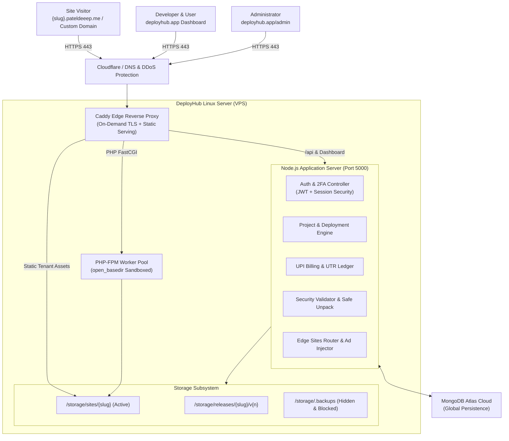

# DeployHub — Modern Web Deployment & Hosting Platform

> **Deploy. Host. Scale.**  
> A lightweight, secure, developer-first cloud platform for hosting Static HTML/CSS/JS, Single Page Applications (React, Vite, Vue), and sandboxed PHP web applications with zero-downtime atomic releases and automated on-demand TLS.

---

## 🌟 Key Highlights

* **Clean Modern Light Theme**: Complete, accessible, high-contrast light UI design across all dashboards, project inspectors, billing, and administration views.
* **Safe ZIP-Only Pipeline**: Hardened admission validator enforcing standard `.zip` archives, strict extension allowlists, 100:1 compression ratio bomb defense, and directory jail traversal checks.
* **Zero-Downtime Atomic Releases**: Every build is stored immutably in `/storage/releases/{slug}/v{version}` and atomically linked to `/storage/sites/{slug}` with one-click instant rollbacks.
* **Two-Domain Origin Isolation**: Control plane traffic (`deployhub.app`) is strictly isolated from tenant user code execution (`*.pateldeeep.me`) to eliminate XSS and session hijacking.
* **Automated On-Demand TLS**: Caddy edge reverse proxy with cryptographic on-demand TLS authorization via DeployHub's `/internal/tls-ask` endpoint.
* **Manual UPI Billing Engine**: Indian UPI payment integration supporting ₹30 Developer and ₹399 Pro tiers with strict 12-digit bank UTR fraud validation and admin review workflows.
* **Protected Hidden Backups**: Automated database snapshots stored in an OS-hidden, HTTP-blocked directory (`storage/.backups/`) with zero exposure to Git or web visitors.

---

## 🏗️ System Architecture



---

## 🔒 Security Architecture

| Security Layer | Mechanism & Implementation |
| :--- | :--- |
| **Origin Isolation** | Control plane (`deployhub.app`) and tenant sites (`pateldeeep.me`) run on separate root domains with independent cookie scopes. |
| **Archive Admission** | Standard `.zip` only (RAR/TAR rejected). Maximum 5,000 files, 25 MB single file limit, 100:1 max compression ratio bomb defense. |
| **Extension Allowlist** | Only web assets permitted (`.html`, `.css`, `.js`, `.json`, `.svg`, `.png`, `.jpg`, `.woff2`, `.php`, etc.). Executables (`.exe`, `.sh`, `.bat`) are blocked. |
| **Directory Jail Check** | Recursive post-extraction `fs.realpathSync()` verifies that no file escapes the target site directory. Symlinks and hardlinks are rejected. |
| **Process Sandboxing** | Systemd unit runs Node.js as an unprivileged user (`deployhub`) with `NoNewPrivileges=true`, `PrivateTmp=true`, `ProtectSystem=full`. |
| **PHP Isolation** | PHP-FPM pool enforces `open_basedir = /var/www/deployhub/storage/sites:/tmp` and disables dangerous functions (`exec`, `system`, `passthru`, `proc_open`, `popen`). |
| **Backup Protection** | Snapshots stored in `storage/.backups` with Windows/Linux hidden attributes and an HTTP router-level blocker returning `403 Forbidden`. |
| **Admin 2FA** | Administrator accounts require email-dispatched 6-digit OTP codes for all session logins. |

---

## 💳 Plan Tiers & UPI Billing

DeployHub provides straightforward monetization via static Indian UPI QR/VPA payments with manual 12-digit bank UTR verification:

| Feature | Free Tier | Developer Tier | Pro Tier |
| :--- | :--- | :--- | :--- |
| **Monthly Price** | **₹0** (Free Forever) | **₹30** / month | **₹399** / month |
| **Hosted Sites** | Up to 3 Websites | Up to 20 Websites | **Unlimited** Websites |
| **Storage Quota** | 1 GB SSD | 10 GB SSD | 50 GB SSD |
| **Monthly Bandwidth** | 10 GB / month | 100 GB / month | 500 GB / month |
| **Ad Network** | Platform Ad Banner | **100% Ad-Free** | **100% Ad-Free** |
| **Custom Domains** | Subdomain only | **1 Verified Custom Domain** | **Unlimited Custom Domains** |
| **Deployment Engine** | In-Memory / BullMQ | Priority Queue Pipeline | High-Concurrency Pipeline |

### Payment Flow
1. User selects **Developer** or **Pro** plan in the Billing tab.
2. System presents the static UPI QR code and official VPA.
3. User completes payment via any UPI app (Google Pay, PhonePe, Paytm, BHIM) and inputs the **12-digit numeric Bank UTR**.
4. System validates format (`/^\d{12}$/`) and checks for collision/duplication.
5. Record enters `PENDING` status; administrator reviews and clicks **Approve** in Mission Control to immediately activate the plan for 30 days.

---

## 📁 Directory Structure (Modular Monolith)

```
deployhub/
├── deploy/                  # Production Deployment Configurations
│   ├── Caddyfile            # Caddy reverse proxy & on-demand TLS
│   ├── deployhub.service    # Hardened systemd service unit
│   └── site-pool.conf       # Sandboxed PHP-FPM pool template
├── server/                  # Core Node.js / Express Application
│   ├── config/              # Environment parsing & configuration
│   ├── controllers/         # Request controllers (Auth, Deployments, Billing, Admin)
│   ├── database/            # Persistent DataStore, Atlas synchronization & models
│   ├── middleware/          # SecurityValidator, Auth, Rate limiters
│   ├── queue/               # Deployment pipeline queue (Memory / BullMQ)
│   ├── router/              # Edge site router & dynamic ad injection
│   ├── routes/              # Versioned API routes (/api/v1)
│   ├── services/            # Domain expiry, Namecheap DNS, Email OTP
│   ├── validators/          # Zod schema validation
│   └── index.ts             # Server entrypoint
├── src/                     # Frontend Client (React 18 + Vite + Tailwind CSS)
│   ├── components/          # Reusable UI components & navigation
│   ├── context/             # Authentication & session state
│   ├── pages/               # Dashboard, AdminPage, BillingPage, Auth pages
│   └── services/            # Axios API client
├── storage/                 # Data and deployment storage (Excluded from Git)
│   ├── .backups/            # [HIDDEN] Timestamped state snapshots
│   ├── artifacts/           # Temporary staging artifacts
│   ├── data/                # Local database state file (deployhub_state.json)
│   ├── releases/            # Immutable versioned releases (/releases/{slug}/v{n})
│   ├── sites/               # Active live site directories (/sites/{slug})
│   └── uploads/             # Incoming ZIP upload staging
├── .env.example             # Environment variable template
├── .gitignore               # Strict Git exclusion rules
├── package.json             # Scripts & dependency definitions
├── README.md                # Project documentation
└── SECURITY.md              # Security policies & vulnerability reporting
```

---

## ⚡ Quick Start

### Prerequisites
* **Node.js**: v18.0.0 or higher
* **npm**: v9.0.0 or higher
* *(Optional)* **MongoDB Atlas** connection string & **Redis** for production queueing

### 1. Installation
```bash
git clone https://github.com/pateldeep04/deployment-platefrom.git
cd deployment-platefrom
npm install
```

### 2. Environment Configuration
Copy `.env.example` to `.env` and configure your credentials:
```bash
cp .env.example .env
```
Key variables:
* `PORT=5000` — Backend API port
* `ADMIN_EMAIL=admin@pateldeeep.me` — Default administrator email
* `ADMIN_PASSWORD=AdminDeployHub2026!` — Administrator password
* `JWT_SECRET` — 32+ character random secret string
* `MONGO_URI` — MongoDB Atlas URI (optional; falls back to built-in local store)

### 3. Development Mode (Frontend + Backend)
Run both the Vite React dev server (`:3000`) and the Express API server (`:5000`) concurrently with hot reload:
```bash
npm run dev
```
* **Frontend Dashboard**: `http://localhost:3000`
* **API Root**: `http://localhost:5000/api/v1`
* **Admin Mission Control**: `http://localhost:3000/admin`

### 4. Production Build
```bash
npm run build
```
Builds the Vite React application into `dist/` and compiles the TypeScript backend into `dist/server/`.

---

## 📡 REST API Reference (`/api/v1`)

### Authentication & Sessions
* `POST /auth/register` — Register account and send 6-digit verification OTP
* `POST /auth/verify-email` — Verify email OTP and establish session
* `POST /auth/login` — Sign in with email and password (enforces Admin 2FA)
* `POST /auth/verify-admin-2fa` — Verify admin 6-digit security code
* `POST /auth/otp/request` — Request passwordless 1-time email login code
* `POST /auth/otp/verify` — Verify passwordless code and obtain session
* `GET /auth/me` — Retrieve active authenticated user profile

### Projects & Deployments
* `GET /projects` — List user's active websites and metrics
* `POST /projects` — Create a new project (Static HTML, SPA, or PHP)
* `GET /projects/:id` — Retrieve project configuration and deployment history
* `DELETE /projects/:id` — Delete project and remove all deployed files
* `POST /projects/:id/deploy` — Upload ZIP archive and execute deployment pipeline
* `GET /deployments/:id/logs` — Stream deployment terminal logs
* `POST /deployments/:id/rollback` — Instant atomic rollback to previous release
* `POST /projects/:id/renew` — Reset 90-day activity timer for free tier subdomains

### Custom Domains
* `POST /projects/:id/domains` — Add custom domain and generate DNS TXT verification token
* `POST /projects/:id/domains/verify` — Query DNS TXT records to activate custom domain

### Billing & Payments
* `GET /billing/plans` — Fetch active tier quotas and pricing
* `POST /billing/upi/submit-utr` — Submit 12-digit numeric bank UTR for review
* `GET /billing/history` — List user's payment transaction history

### Administrator Mission Control (`role === 'ADMIN'`)
* `GET /admin/stats` — Real-time CPU, RAM, disk storage, and queue telemetry
* `GET /admin/users` — List and manage user accounts
* `POST /admin/users/:id/ban` — Suspend user account and deactivate all hosted sites
* `POST /admin/users/:id/unban` — Restore suspended account
* `GET /admin/payments` — Audit ledger of all submitted UPI payments
* `PATCH /admin/payments/:id` — Approve or reject payment and activate plan
* `GET /admin/domains` — Platform routing domains manager
* `GET /admin/security/logs` — Security incident audits and blocked intrusion events

### Internal System Endpoints
* `GET /internal/tls-ask?domain=...` — Caddy On-Demand TLS authorization check (Localhost only)

---

## 📄 License & Security

* **Security Policy**: See [`SECURITY.md`](./SECURITY.md) for vulnerability reporting guidelines and defense tiers.
* **Architecture Design**: See [`ARCHITECTURE.md`](./ARCHITECTURE.md) for complete technical architecture documentation.
* **License**: MIT License. Copyright &copy; 2026 DeployHub.
